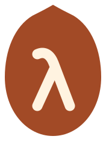

<p align="center">
  
</p>

<h1 align="center">Pestka</h1>

<p align="center">
  A Lean 4 kernel, written in <a href="https://github.com/jasisz/aver">Aver</a>.
</p>

<p align="center">
  <a href="#written-in-aver">Aver</a> ·
  <a href="#try-it">Try it</a> ·
  <a href="#what-it-checks">What it checks</a> ·
  <a href="docs/architecture.md">Inside the kernel</a> ·
  <a href="docs/benchmarks.md">Benchmarks</a>
</p>

---

Pestka checks Lean proofs with its own implementation of Lean’s type theory.
Give it a [lean4export](https://github.com/leanprover/lean4export) file and it
checks the declarations, down to universe levels, reduction and recursors.
Lean itself is not involved in the check.

Pestka follows the reference kernel's substitution-based approach.
**It does not use normalization by evaluation (NbE).** The experiment is
how far you can push that algorithm with better sharing, caching and
reduction.

It checks **all of mathlib**: 702,040 declarations in the recorded export.
The same Aver source also compiles to **WebAssembly**, where it checks the
same corpus under V8. On the small Lean Kernel Arena suite, the recorded
result is **179/179 correct**. [Measurements and setup →](docs/benchmarks.md)

*Pestka* is Polish for a fruit stone — a kernel. It's also what you call
something that's a piece of cake.

## Written in Aver

[Aver](https://github.com/jasisz/aver) is a statically typed, pure functional
language designed for AI to write and humans to review. Pestka is written
by an AI agent under human guidance, and gives the language a substantial
program to work on: a proof checker running over all of mathlib. The same
source runs natively through Aver's Rust backend and as WebAssembly through
its own wasm-gc backend.

There is a connection in the other direction, too. Aver can send laws from
its source to Lean for proof checking. Pestka uses those laws to state
properties of substitution, universe arithmetic and the metadata its
optimizations rely on. Some already have proofs checked by Lean;
[the verification notes](docs/development.md#laws) describe which ones.
So Lean checks properties of code written in Aver, while that code checks
Lean proofs.

## Try it

You need a Rust toolchain. From a checkout of this repository:

```sh
# Install the Aver version this checkout uses.
cargo install aver-lang --version "$(cat .aver-version)" --locked

# Build the native checker and try a small included export.
bin/build
.build/target/release/main tests/export/wellformed/small.ndjson
```

The last line should be:

```text
accepted
```

To check your own export:

```sh
.build/target/release/main MyModule.ndjson
```

Pestka uses eight workers by default. Pass a worker count as the second
argument, for example `MyModule.ndjson 1`. Each declaration sees only the
environment available at its position in the file; the verdict reports the
first failure in file order.

For a smaller memory footprint, pass `--low-memory` before the file name.
See [low-memory mode](docs/usage.md#low-memory-mode) for the tradeoff.

Need an export first? See [producing input](docs/usage.md#producing-input).
Lean and `lean4export` are needed to make the file, but not to check it.

## What it checks

Pestka implements Lean's type theory, including:

- Universe polymorphism and definitional equality.
- Mutual and nested inductive types, with recursors derived by Pestka and
  compared against the export.
- Quotients, proof irrelevance, and the Nat and String literal extensions.

The input format is **lean4export NDJSON 3.1.0**. The last output line and
exit code give the result:

| Output | Exit code | Meaning |
| :--- | :---: | :--- |
| `accepted` | `0` | The check passed. |
| `rejected: <why>` | `1` | The input failed a check. |
| `declined: <why>` | `2` | The input needs something Pestka does not support. |

Axioms are assumptions: Pestka checks their types, not proofs of them.
Unsafe and partial declarations are skipped and kept out of the logical
environment. If an inductive block cannot be checked, the final result is
`declined`, never `accepted`.

## A few things inside

**Variables can be reused across proofs.** A fresh name every time a binder
opens makes equivalent terms look different to a cache. Pestka identifies
a free variable by its type, value and how many of the same kind are already
open. Distinct variables in one scope stay distinct; equivalent binders
elsewhere can reuse earlier inference, reduction and equality results.
Those results survive between declarations in bounded caches.

**Recursive definitions can produce their own shortcuts.** When a definition
is unfolded often enough, Pestka reduces it on fresh variables and splits
on the constructors its recursor needs. That produces a tree of reduction
rules for later calls. The rules come from the definition's body, and can
skip repeated unfolding, pattern matching and structural recursion machinery.

**Proof arguments needn't be compared.** Lean treats proofs of the same
proposition as equal. When comparing two applications of a constant,
Pestka reads the argument types from the constant's signature. Once earlier
arguments agree, a proof argument can be skipped: its proposition is already
the same on both sides. This avoids walking through potentially large proofs
just to establish an equality the type theory already gives us.

**Checking order matters.** On large inputs, workers group declarations by
namespace so related proofs meet the same cached results before they are
evicted. This cut about 9% of the instructions on mathlib. Reordering is
allowed only when the reader has established that every constant reference
points backwards in the file; failures are still reported in file order.

**Failed comparisons are useful results.** During a declaration, the checker
also remembers pairs of terms it found definitionally unequal. Otherwise,
trying different routes through an equality problem can repeat the same
expensive dead end hundreds of times.

The [implementation notes](docs/architecture.md) cover these ideas, the lazy
reduction machine, term representation and the measurements behind them.

## Also runs as WebAssembly

Aver has its own wasm-gc backend. It compiles the same checker directly to
WebAssembly; terms, maps and closures become garbage-collected objects in
the engine.

With Node 24 or later and Binaryen's `wasm-opt` installed:

```sh
cargo install aver-lang --version "$(cat .aver-version)" --locked --features wasm
bin/build-wasm
bin/run-wasm tests/export/wellformed/small.ndjson
```

The runner uses V8 and checks that the verdict agrees with the exit status.
A host failure exits with `3`. Native and wasm measurements, including
mathlib, are in the [benchmark tables](docs/benchmarks.md).

## Working on Pestka

```sh
aver check . --module-root .     # Types, effects and lint
aver verify . --module-root .    # Examples and laws
bin/build
tests/run.sh                    # Accepted, rejected and unsupported fixtures
```

The core lives in [`core/`](core), the checker in [`check/`](check), and the
export reader in [`export/`](export). [`main.av`](main.av) ties them together.

For a closer look:

- [Build and run](docs/usage.md) — exports, PGO, command reference and runtimes.
- [Inside the kernel](docs/architecture.md) — algorithms and optimizations.
- [Benchmarks](docs/benchmarks.md) — native and WebAssembly results, with setup.
- [Development](docs/development.md) — tests, laws and the source map.
